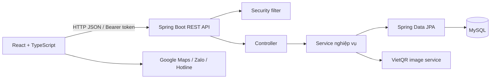
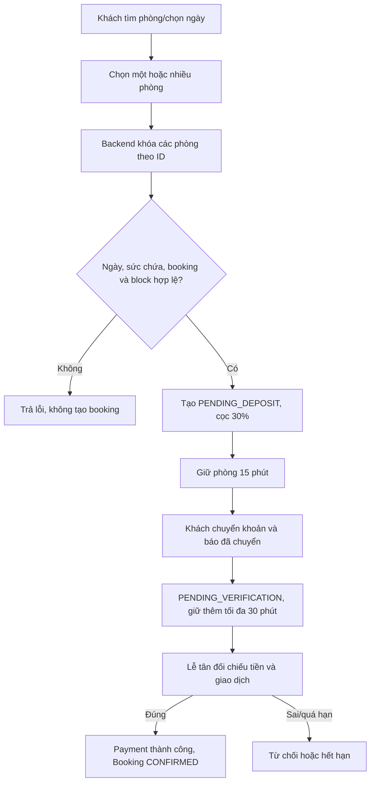

# Hotel Management System

Ứng dụng quản lý khách sạn gồm cổng đặt phòng cho khách hàng và không gian vận hành dành cho lễ tân. Dự án mô phỏng các nghiệp vụ đặt phòng, giữ chỗ, xác minh tiền cọc và phục vụ khách lưu trú; được xây dựng cho mục đích học tập môn Lập trình hướng đối tượng Java.

## Mục lục

1. [Giới thiệu](#1-giới-thiệu)
2. [Tính năng](#2-tính-năng)
3. [Công nghệ](#3-công-nghệ)
4. [Kiến trúc](#4-kiến-trúc)
5. [Cấu trúc thư mục](#5-cấu-trúc-thư-mục)
6. [Yêu cầu hệ thống](#6-yêu-cầu-hệ-thống)
7. [Cài đặt và chạy](#7-cài-đặt-và-chạy)
8. [Cấu hình môi trường](#8-cấu-hình-môi-trường)
9. [Luồng nghiệp vụ](#9-luồng-nghiệp-vụ)
10. [Cơ sở dữ liệu](#10-cơ-sở-dữ-liệu)
11. [REST API](#11-rest-api)
12. [Screenshots](#12-screenshots)
13. [Kiểm thử](#13-kiểm-thử)
14. [Hạn chế hiện tại](#14-hạn-chế-hiện-tại)
15. [Hướng phát triển](#15-hướng-phát-triển)
16. [Thông tin dự án](#16-thông-tin-dự-án)

## 1. Giới thiệu

Hotel Management System hỗ trợ quản lý danh mục phòng, tìm phòng theo ngày, đặt một hoặc nhiều phòng, theo dõi booking, xử lý tiền cọc và vận hành lưu trú.

- **Khách hàng:** tìm phòng, gửi yêu cầu đặt, thanh toán cọc và theo dõi booking.
- **Lễ tân:** xử lý booking, xác minh giao dịch cọc, phục vụ check-in/check-out và quản lý dịch vụ/hóa đơn.
- **Quản trị viên:** entity và role ROLE_ADMIN có trong mô hình; giao diện và quyền quản trị chưa hoàn thiện thành vai trò sử dụng đầy đủ.

## 2. Tính năng

### Khách hàng

- Đăng ký, đăng nhập, sửa hồ sơ, đổi mật khẩu.
- Xem loại phòng; lọc theo ngày, sức chứa, giá; xem lịch phòng.
- Chọn nhiều phòng vật lý cho một booking.
- Gửi yêu cầu đặt phòng với kiểm tra availability phía backend.
- Thanh toán cọc qua chuyển khoản VietQR; báo đã chuyển khoản để lễ tân xác minh.
- Xem booking, trạng thái cọc, lịch sử hoàn tiền; hủy theo chính sách backend.
- Yêu cầu dịch vụ khi lưu trú và xem hóa đơn.
- Xem vị trí khách sạn/chỉ đường Google Maps; liên hệ Zalo/Hotline nếu đã cấu hình.
- Xem gợi ý phòng liên quan hoặc phòng thay thế dựa trên luật về giá, sức chứa, hạng phòng và tiện nghi.

### Lễ tân

- Xem dashboard, danh sách khách, booking và phòng.
- Tạo, xác nhận, từ chối, hủy booking; đổi phòng khi thỏa điều kiện.
- Xác minh/từ chối báo cáo chuyển khoản.
- Check-in/check-out; quản lý trạng thái phòng và thời gian khóa phòng.
- Quản lý loại phòng, dịch vụ, hóa đơn, khoản thanh toán và tác vụ hoàn tiền.

Role trong source: ROLE_CUSTOMER, ROLE_RECEPTIONIST, ROLE_ADMIN. React hiện chỉ cho ROLE_CUSTOMER vào khu customer và ROLE_RECEPTIONIST vào khu lễ tân.

## 3. Công nghệ

| Thành phần | Công nghệ | Vai trò |
|---|---|---|
| Backend | Java 21, Spring Boot 3.5.7 | REST API và nghiệp vụ |
| Persistence | Spring Data JPA, Hibernate | ORM/truy vấn |
| Database | MySQL Connector/J, MySQL dialect | Lưu dữ liệu |
| Authentication | Spring Security, JWT HS256, BCrypt | Bearer token, mã hóa mật khẩu |
| Frontend | React 19, TypeScript 5.9, Vite 7 | Cổng khách hàng và lễ tân |
| Frontend data/forms | TanStack Query, Axios, React Hook Form, Zod | API state, HTTP, biểu mẫu |
| Build | Maven Wrapper 3.9.16, npm | Build ứng dụng |
| Tests | JUnit 5, Spring Boot Test, Mockito, Vitest, Testing Library | Unit, integration, component |
| Tích hợp ngoài | VietQR image service, Google Maps embed/link, Zalo, tel link | QR, chỉ đường và liên hệ |

Phiên bản backend xác định trong pom.xml; frontend trong frontend/package.json và frontend/package-lock.json. Vite trong lockfile yêu cầu Node 20.19+ hoặc 22.12+.

## 4. Kiến trúc

Frontend gọi REST API qua Axios. Backend phân tách controller, service, repository và entity. Spring Data JPA/Hibernate làm việc với MySQL; bearer JWT được kiểm tra ở security filter.



Các module backend chính: controller, DTO, service/impl, repository, entity/enums, security/config và strategy/pricing.

## 5. Cấu trúc thư mục

```text
hotel-management-system/
├── src/main/java/com/hotel/
│   ├── config/       # Security, cấu hình booking/VietQR, tác vụ hết hạn
│   ├── controller/  # REST API
│   ├── dto/         # Request và response
│   ├── entity/      # JPA entities
│   ├── enums/       # Trạng thái và role
│   ├── repository/  # Truy vấn dữ liệu
│   ├── security/    # JWT filter/service
│   ├── service/     # Nghiệp vụ
│   └── strategy/    # Chiến lược giá/thanh toán
├── src/main/resources/ # YAML, schema và dữ liệu seed
├── src/test/java/      # Backend tests
├── frontend/src/
│   ├── components/  # Layout, payment panels, UI
│   ├── config/      # Cấu hình vị trí khách sạn
│   ├── lib/         # API client, auth, types, helpers
│   └── pages/       # Trang khách hàng và lễ tân
├── docs/            # Tài liệu UML
├── backend.env.example
├── pom.xml
├── mvnw / mvnw.cmd
└── README.md
```

## 6. Yêu cầu hệ thống

| Thành phần | Yêu cầu |
|---|---|
| JDK | Java 21 (compiler release 21) |
| Node.js | 20.19+ hoặc 22.12+ theo Vite |
| npm | Đi kèm Node.js |
| MySQL | Cần máy chủ MySQL; source không khóa version cụ thể. Khuyến nghị MySQL 8.x |
| Maven | Không cần cài riêng nếu dùng Maven Wrapper |
| Git | Clone repository |

## 7. Cài đặt và chạy

### 7.1 Clone và tạo database

    git clone https://github.com/levanhoan-sys/hotel_management.git
    cd hotel_management

Tạo database rỗng trước khi chạy backend:

    CREATE DATABASE hotel_db CHARACTER SET utf8mb4 COLLATE utf8mb4_unicode_ci;

Hibernate dùng ddl-auto: update; ứng dụng chạy schema-deposit.sql và data.sql lúc khởi động. Database cần tồn tại và user MySQL cần quyền cập nhật schema/seed. Profile dev bổ sung data-dev.sql.

### 7.2 Cấu hình và chạy backend

Sao chép backend.env.example để tham khảo, rồi thiết lập biến môi trường trong shell đang chạy ứng dụng. Spring Boot không tự đọc file .env.

PowerShell:

    $env:DB_HOST = "localhost"
    $env:DB_PORT = "3306"
    $env:DB_NAME = "hotel_db"
    $env:DB_USERNAME = "your_mysql_username"
    $env:DB_PASSWORD = "your_mysql_password"
    $env:ACCESS_TOKEN_SECRET = "replace-with-a-random-secret-at-least-32-bytes"
    $env:CORS_ALLOWED_ORIGINS = "http://localhost:5173"
    .mvnw.cmd spring-boot:run

macOS/Linux: export các biến tương ứng rồi chạy:

    ./mvnw spring-boot:run

Backend mặc định chạy tại http://localhost:8080. Để tạo lễ tân ban đầu, đặt APP_BOOTSTRAP_RECEPTIONIST_USERNAME và APP_BOOTSTRAP_RECEPTIONIST_PASSWORD trước khi khởi động. Tài khoản chỉ được tạo nếu username chưa tồn tại; khách có thể tự đăng ký.

### 7.3 Chạy frontend

Mở terminal khác:

    cd frontend
    Copy-Item .env.example .env
    npm install
    npm run dev

Mở http://localhost:5173. Có thể để VITE_API_BASE_URL theo mặc định nếu backend chạy local cổng 8080. Với macOS/Linux, lệnh copy file tương ứng là cp .env.example .env.

### 7.4 Dữ liệu demo

Đặt SPRING_PROFILES_ACTIVE=dev để nạp data-dev.sql. Tài khoản demo trong seed dùng chung mật khẩu hotel-demo-2026; chỉ dùng local, không dùng trên môi trường thật. Dữ liệu phòng/loại phòng/dịch vụ từ data.sql vẫn được nạp ở cấu hình mặc định.

## 8. Cấu hình môi trường

### Backend

Giá trị mặc định xem trong src/main/resources/application.yml.

| Biến | Bắt buộc | Mô tả |
|---|---:|---|
| DB_HOST, DB_PORT, DB_NAME | Nếu khác mặc định | Host/cổng/tên database; mặc định localhost:3306/hotel_db |
| DB_USERNAME, DB_PASSWORD | Triển khai | User/password MySQL; mặc định local root/root |
| ACCESS_TOKEN_SECRET | Có | Khóa JWT tối thiểu 32 byte. Giá trị mặc định chỉ dành local |
| CORS_ALLOWED_ORIGINS | Không | Danh sách origin phân cách bằng dấu phẩy |
| HOTEL_BANK_BIN | Tùy chọn local | BIN ngân hàng 6 chữ số cho VietQR |
| HOTEL_BANK_ACCOUNT | Tùy chọn local | Tài khoản ngân hàng 6–20 chữ số |
| HOTEL_BANK_ACCOUNT_NAME | Tùy chọn local | Tên chủ tài khoản |
| APP_BOOTSTRAP_RECEPTIONIST_USERNAME | Không | Username lễ tân đầu tiên |
| APP_BOOTSTRAP_RECEPTIONIST_PASSWORD | Không | Mật khẩu khởi tạo, mã hóa BCrypt |
| SPRING_PROFILES_ACTIVE | Không | Đặt dev để nạp dữ liệu demo |

Ba biến cấu hình ngân hàng để trống cùng lúc cho phép backend khởi động local nhưng QR không hoạt động; cấu hình dở dang/sai định dạng làm ứng dụng lỗi khởi động. Giá trị nghiệp vụ nằm trong YAML: cọc 30%, giữ phòng 15 phút, giờ check-in 14:00, Asia/Ho_Chi_Minh, mốc miễn phí hủy 72 giờ và mốc một phần 24 giờ. Các giá trị này không có env override trong source hiện tại.

### Frontend Vite

Sao chép frontend/.env.example thành frontend/.env. Vite đọc các biến khi chạy/build; khởi động lại Vite sau khi sửa.

| Biến | Mô tả |
|---|---|
| VITE_API_BASE_URL | Base URL API; mặc định trong client http://localhost:8080/api |
| VITE_ZALO_PERSONAL_URL | Link HTTPS hồ sơ Zalo công khai; chỉ chấp nhận host zalo.me |
| VITE_HOTLINE_NUMBER | Số điện thoại công khai |
| VITE_HOTEL_NAME, VITE_HOTEL_ADDRESS | Tên và địa chỉ trên trang vị trí |
| VITE_HOTEL_LATITUDE, VITE_HOTEL_LONGITUDE | Tọa độ thập phân hợp lệ |
| VITE_HOTEL_MAP_EMBED_URL | HTTPS Google Maps /maps/embed; không cần Maps JavaScript API key |

Các giá trị vị trí/liên hệ là tùy chọn. Thiếu cấu hình thì bản đồ/nút liên hệ tương ứng bị ẩn hoặc hiện placeholder. Biến VITE_* là dữ liệu public, không đặt secret/mật khẩu/token.

## 9. Luồng nghiệp vụ

### Đặt phòng và tiền cọc



Booking lưu từng phòng vật lý trong BookingDetail. Khoảng ngày dùng quy tắc [checkIn, checkOut); availability xét booking đang giữ hiệu lực/đã xác nhận/đang lưu trú và RoomBlock. Backend kiểm tra lại và khóa phòng khi tạo booking để hạn chế đặt trùng.

Khách chỉ báo đã chuyển khoản; thao tác này không đánh dấu payment thành công. Lễ tân kiểm tra sao kê, xác nhận số tiền chính xác và mã giao dịch chưa dùng. QR là ảnh lấy từ dịch vụ VietQR bên ngoài. Chi tiết: [VIETQR_INTEGRATION.md](VIETQR_INTEGRATION.md), [DEPOSIT_PAYMENT_FLOW.md](DEPOSIT_PAYMENT_FLOW.md), [MANUAL_PAYMENT_VERIFICATION.md](MANUAL_PAYMENT_VERIFICATION.md).

### Lưu trú, hóa đơn và hoàn tiền

Lễ tân check-in booking đã xác nhận, ghi nhận dịch vụ phát sinh, lập/cập nhật và phát hành hóa đơn, ghi nhận khoản thanh toán rồi hoàn tất check-out theo trạng thái backend. Có luồng theo dõi và xử lý hoàn tiền bởi nhân viên; hệ thống không tự chuyển tiền hoàn tới ngân hàng.

## 10. Cơ sở dữ liệu

Ứng dụng dùng MySQL và JPA/Hibernate. Hibernate cập nhật schema entity bằng ddl-auto: update; schema-deposit.sql cập nhật tương thích bảng payments; data.sql và profile dev nạp dữ liệu mẫu. Không có Flyway/Liquibase trong dependencies hiện tại.

| Entity | Vai trò |
|---|---|
| User, Customer, Employee, Receptionist, Admin | Tài khoản/phân loại người dùng; inheritance JOINED |
| RoomType, Room, ServiceItem | Hạng phòng, phòng vật lý, dịch vụ |
| Booking, BookingDetail, RoomBlock | Booking, phòng trong booking, khoảng phòng bị khóa |
| Payment, Invoice, InvoiceItem, Refund | Cọc/số dư, hóa đơn và hoàn tiền |
| ServiceOrder | Dịch vụ sử dụng trong booking |

Một khách có nhiều booking; booking có nhiều booking detail; mỗi detail tham chiếu phòng vật lý; phòng thuộc một RoomType. Booking liên quan đến payment, invoice và service order. Sơ đồ hiện có tại [docs/hotel_management_uml_design.md](docs/hotel_management_uml_design.md); tài liệu UML có thể chưa theo kịp thay đổi mới, vì vậy entity/repository hiện tại mới là nguồn chuẩn.

## 11. REST API

Base URL local: http://localhost:8080/api. Response thông thường dùng ApiResponse với success, message, data, timestamp. Các endpoint đọc phòng/catalog được công khai; booking/hồ sơ/hóa đơn cần bearer token; nhóm /reception được bảo vệ theo role lễ tân.

| Nhóm | Một số endpoint |
|---|---|
| Auth | POST /auth/register, POST /auth/login, GET /auth/me |
| Phòng | GET /rooms, GET /rooms/{id}, GET /rooms/available, GET /rooms/{id}/calendar |
| Recommendation | GET /rooms/recommendations |
| Catalog | GET /room-types, GET /services |
| Booking khách | POST /bookings, GET /bookings/me, GET /bookings/{id}, PATCH /bookings/{id}/cancel |
| Cọc | GET /bookings/{id}/deposit, GET /bookings/{id}/deposit/qr, POST /bookings/{id}/deposit/report |
| Xác minh cọc | GET /reception/deposits/pending, POST /reception/deposits/{bookingId}/confirm, POST /reception/deposits/{bookingId}/reject |
| Vận hành | GET /reception/summary, GET /reception/bookings, POST /reception/bookings/{id}/check-in, POST /reception/bookings/{id}/check-out |
| Hóa đơn/dịch vụ | Các route /reception/invoices/**, /reception/services/** và /bookings/{id}/services |
| Hồ sơ/hoàn tiền | /users/me, /bookings/{id}/refunds, /reception/refunds |

Recommendation nhận referenceRoomId hoặc roomTypeId, checkIn/checkOut, guests, roomQuantity, alternatives và limit. Có ngày thì gợi ý kiểm availability theo query hiện có; không có ngày thì không khẳng định số phòng còn trống. Scoring là rule-based, không dùng AI/ML.

Swagger/OpenAPI UI chưa được cấu hình trong dependencies; matcher bảo mật cho Swagger không có nghĩa endpoint Swagger đang tồn tại. Request/response chi tiết: [frontend/API_CONTRACT.md](frontend/API_CONTRACT.md); các gap được ghi tại [frontend/API_GAPS.md](frontend/API_GAPS.md).

## 12. Kiểm thử

Backend:

    .mvnw.cmd test

Frontend (chạy trong thư mục frontend):

    npm test
    npm run lint
    npm run build

Backend có unit tests cho service và integration test Spring Boot cho đặt phòng đồng thời; H2 có trong test dependencies. Frontend có Vitest/Testing Library tests cho API client, booking helpers và trang customer; test frontend dùng mock HTTP, không thay thế end-to-end với MySQL.

Trong lần cập nhật README này không chạy lại test suite; không công bố coverage hay tỷ lệ pass.

## 13. Hạn chế hiện tại

- Tiền cọc được xác minh thủ công bởi lễ tân; chưa có webhook ngân hàng. Ảnh QR được tải từ dịch vụ VietQR ngoài.
- Hoàn tiền do nhân viên xử lý; không có tích hợp chuyển tiền hoàn tự động.
- Source có strategy CASH/CREDIT_CARD/VNPAY nhưng không đồng nghĩa đã tích hợp nhà cung cấp gateway; thanh toán số dư hiện là quy trình ghi nhận thủ công của lễ tân.
- Admin có entity/role enum nhưng chưa có console/cấp tài khoản quản trị hoàn chỉnh. Guard React hiện chỉ cho ROLE_RECEPTIONIST vào UI lễ tân.
- Cấu hình root/root và JWT development chỉ phục vụ local; phải thay trước khi triển khai.
- Không có migration versioning, thông báo email/SMS, hoặc bộ test end-to-end trình duyệt.
- Một số tài liệu API/UML cũ có thể chưa đồng bộ source; controller và DTO là nguồn chuẩn.

## 14. Hướng phát triển

- Tích hợp gateway/ngân hàng với webhook xác thực và đối soát tự động.
- Tích hợp hoàn tiền thật, email/SMS và cơ chế retry.
- Hoàn thiện Admin, cấp tài khoản và phân quyền chi tiết.
- Bổ sung migration versioning, observability, deployment production và E2E tests.
- Bổ sung đánh giá, báo cáo doanh thu và hiệu chỉnh trọng số recommendation.
