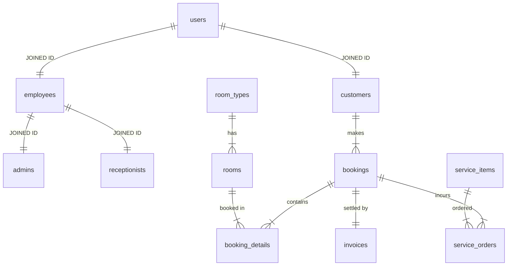

# 🏨 Hotel Management System (Spring Boot + OOP Architecture)

## Chạy giao diện web

Frontend React + TypeScript + Vite nằm trong thư mục `frontend`. Cài Node.js, chạy `cd frontend` rồi `npm install`; sao chép `frontend/.env` thành `frontend/.env` và đặt `VITE_API_BASE_URL` (mặc định `http://localhost:8080/api`); sau đó chạy `npm run dev`. Khởi động Spring Boot và MySQL như hướng dẫn bên dưới. Lệnh kiểm tra frontend là `npm run build` và `npm run lint`. Chi tiết API đã xác minh cùng các giới hạn backend nằm trong [frontend/README.md](frontend/README.md).

Để chạy backend trên PowerShell, nạp DB và khóa truy cập từ môi trường, sau đó chạy Maven:

```powershell
$env:DB_USERNAME = "<tên MySQL>"
$env:DB_PASSWORD = "<mật khẩu MySQL>"
$env:ACCESS_TOKEN_SECRET = "<chuỗi ngẫu nhiên tối thiểu 32 byte>"
$env:APP_BOOTSTRAP_RECEPTIONIST_USERNAME = "le-tan"
$env:APP_BOOTSTRAP_RECEPTIONIST_PASSWORD = "<mật khẩu riêng>"
mvn spring-boot:run
```

> Lưu ý: các phần kiến trúc/API bên dưới phản ánh thiết kế ban đầu. Phần [Phiên bản cổng đặt phòng và lễ tân](#phiên-bản-cổng-đặt-phòng-và-lễ-tân) ở cuối tài liệu mô tả backend hiện tại, cấu hình xác thực và quy tắc quyền mới.

## Phiên bản cổng đặt phòng và lễ tân

Frontend đã được tổ chức lại thành cổng đặt phòng cho khách và khu vực vận hành lễ tân. Backend hiện có đăng ký/đăng nhập khách hàng, bearer token HMAC có hạn 24 giờ, phân quyền khách/lễ tân, catalog loại phòng/dịch vụ, booking theo chủ sở hữu, danh sách khách, thống kê doanh thu và ảnh phòng. Khởi động backend bằng `mvn spring-boot:run` sau khi tạo MySQL database `hotel_db`; `data.sql` được chạy sau khi Hibernate cập nhật schema và seed phòng/dịch vụ mẫu với giá VND.

Để tạo tài khoản lễ tân đầu tiên, đặt hai biến môi trường `APP_BOOTSTRAP_RECEPTIONIST_USERNAME` và `APP_BOOTSTRAP_RECEPTIONIST_PASSWORD` trước khi khởi chạy. Backend chỉ tạo tài khoản nếu username chưa tồn tại. Khách có thể tự đăng ký, nhưng không thể tự chọn role lễ tân.

Để nạp bộ dữ liệu demo đầy đủ (1 lễ tân, 2 khách hàng và booking ở nhiều trạng thái), bật profile `dev` trước khi chạy backend: `$env:SPRING_PROFILES_ACTIVE = "dev"`. Profile này thêm `data-dev.sql`; tài khoản demo không được nạp ở profile mặc định. Tài khoản `demo.reception`, `demo.customer1` và `demo.customer2` dùng chung mật khẩu `hotel-demo-2026`. Các phòng, loại phòng và dịch vụ mẫu trong `data.sql` vẫn được nạp ở cấu hình mặc định.

Ứng dụng chạy local với MySQL mặc định `root/root` và khóa bearer token development; có thể ghi đè bằng các biến môi trường. Trước khi triển khai, bắt buộc đặt `ACCESS_TOKEN_SECRET` thành giá trị ngẫu nhiên riêng tối thiểu 32 byte và cấu hình DB bằng `DB_HOST`, `DB_PORT`, `DB_NAME`, `DB_USERNAME`, `DB_PASSWORD`; CORS cấu hình qua `CORS_ALLOWED_ORIGINS` (danh sách origin phân tách dấu phẩy). Mẫu biến môi trường có trong [backend.env.example](backend.env.example), nhưng Spring Boot không đọc tệp mẫu này tự động. Các endpoint đọc catalog phòng/dịch vụ được công khai; booking, hóa đơn và hồ sơ được bảo vệ bằng bearer token HMAC 24 giờ; nhóm lễ tân yêu cầu `ROLE_RECEPTIONIST` hoặc `ROLE_ADMIN`.

Tóm tắt route: `POST /api/auth/register`, `POST /api/auth/login`, `GET /api/auth/me`; `GET /api/room-types`, `GET /api/services`; `GET /api/reception/summary`, `/customers`, `/bookings`; khách dùng `GET /api/bookings/me` và các route booking/hóa đơn theo tài khoản. Lễ tân mới có quyền check-out và ghi nhận thu tiền mặt. Chi tiết request và response được triển khai trong controller/DTO và liệt kê ở [frontend/README.md](frontend/README.md).

Thanh toán tiền mặt được ghi nhận qua quy trình check-out. Thẻ và VNPay chưa có tích hợp nhà cung cấp nên backend từ chối hai phương thức này thay vì báo thanh toán thành công giả. Trước khi dùng production cần tích hợp gateway thực, bổ sung chính sách hoàn/hủy và thay khóa development bằng secret triển khai.

> **Môn học:** Lập trình Hướng đối tượng (OOP Java) / Kỹ thuật Phần mềm  
> **Kiến trúc:** Layered Architecture (Controller - Service - Repository - Entity)  
> **Công nghệ chủ đạo:** Java 26, Spring Boot 4.1.x / 3.x, Spring Data JPA, Spring Security Crypto, Spring WebMvc, MySQL, Lombok 1.18.48, MapStruct 1.6.3  
> **Mục tiêu tài liệu:** Cung cấp bức tranh toàn cảnh, chi tiết về kiến trúc, cấu hình build, mô hình dữ liệu, các mẫu thiết kế (Design Patterns), nghiệp vụ và đặc tả API để bất kỳ Kỹ sư phần mềm hoặc AI Agent nào khi đọc vào cũng có thể nắm bắt và tiếp tục phát triển hệ thống một cách chính xác.

---

## 📌 MỤC LỤC
1. [Tổng quan Dự án](#1-tổng-quan-dự-án)
2. [Cấu hình Môi trường & Build (Java 26 + Maven)](#2-cấu-hình-môi-trường--build-java-26--maven)
3. [Cấu trúc Thư mục & Layered Architecture](#3-cấu-trúc-thư-mục--layered-architecture)
4. [Hiện thực 4 Trụ cột OOP & Design Patterns](#4-hiện-thực-4-trụ-cột-oop--design-patterns)
5. [Mô hình Dữ liệu & Quan hệ Thực thể (ERD/Entities)](#5-mô-hình-dữ-liệu--quan-hệ-thực-thể-erdentities)
6. [Thuật toán & Quy trình Nghiệp vụ Cốt lõi](#6-thuật-toán--quy-trình-nghiệp-vụ-cốt-lõi)
7. [Đặc tả REST APIs & Hướng dẫn Kiểm thử](#7-đặc-tả-rest-apis--hướng-dẫn-kiểm-thử)
8. [Hướng dẫn Cài đặt & Khởi chạy CSDL](#8-hướng-dẫn-cài-đặt--khởi-chạy-csdl)
9. [Chỉ dẫn Dành cho AI Agents (Context for AI)](#9-chỉ-dẫn-dành-cho-ai-agents-context-for-ai)

---

## 1. TỔNG QUAN DỰ ÁN

Dự án là hệ thống Backend cho nền tảng quản trị khách sạn hiện đại, phục vụ 3 nhóm đối tượng:
* **Khách hàng (Customer):** Tra cứu phòng trống theo khoảng ngày thực tế, đặt phòng trực tuyến, theo dõi lịch sử và tích điểm thưởng thân thiết (Loyalty points).
* **Lễ tân (Receptionist):** Quản lý trạng thái phòng thời gian thực, xử lý Check-in nhận phòng, gán dịch vụ phát sinh (ăn uống, giặt ủi, minibar), xử lý Check-out và điều phối trạng thái dọn dẹp phòng.
* **Quản trị viên (Admin):** Quản lý danh mục loại phòng, cấu hình phòng, quản lý tài khoản nhân viên.

---

## 2. CẤU HÌNH MÔI TRƯỜNG & BUILD (JAVA 26 + MAVEN)

Dự án được cấu hình tương thích hoàn toàn với các phiên bản JDK hiện đại (Java 26 / JDK 21+):

### 2.1. Quản lý Thư viện (`pom.xml`)
* **Java Version:** `26` (hỗ trợ các tính năng mới nhất của Java).
* **Trình biên dịch & Xử lý Annotation (`maven-compiler-plugin 3.11.0`):**
  * Cấu hình tường minh `annotationProcessorPaths` để kết nối **Lombok** (`1.18.48`) và **MapStruct** (`1.6.3`) thông qua cầu nối `lombok-mapstruct-binding` (`0.2.0`).
  * **Giải quyết triệt để lỗi biên dịch trên JDK mới:** Ngăn chặn hoàn toàn lỗi `java.lang.ExceptionInInitializerError: com.sun.tools.javac.code.TypeTag :: UNKNOWN` vốn thường xảy ra khi dùng Lombok cũ trên các bản JDK mới.
* **Bảo mật:** `spring-security-crypto` cung cấp bộ mã hóa mật khẩu `BCryptPasswordEncoder`.

### 2.2. Bật Annotation Processing trong IDE (IntelliJ IDEA)
Khi mở dự án trên IntelliJ IDEA:
1. Vào **File** $\rightarrow$ **Settings** (`Ctrl + Alt + S`).
2. Điều hướng đến: **Build, Execution, Deployment** $\rightarrow$ **Compiler** $\rightarrow$ **Annotation Processors**.
3. Tích chọn: **`Enable annotation processing`** $\rightarrow$ Chọn **Apply / OK**.

---

## 3. CẤU TRÚC THƯ MỤC & LAYERED ARCHITECTURE

Dự án tuân thủ mô hình **Layered Architecture chuẩn Clean Code**, phân chia gói mã nguồn rõ ràng theo trách nhiệm:

```text
hotel-management-system/
├── pom.xml                                       # Quản lý dependencies Maven (Java 26, Spring Boot, Lombok 1.18.48, MapStruct)
├── .gitignore                                    # Loại trừ target/, .idea/, file tạm
├── README.md                                     # Tài liệu tổng quan dự án (file này)
├── docs/
│   └── hotel_management_uml_design.md            # Tài liệu thiết kế UML chi tiết (Class, Sequence, State, UseCase)
├── src/
│   ├── main/
│   │   ├── java/com/hotel/
│   │   │   ├── HotelManagementApplication.java   # Main Class khởi chạy ứng dụng
│   │   │   │
│   │   │   ├── config/                           # TẦNG CẤU HÌNH
│   │   │   │   └── SecurityConfig.java            # Cấu hình Spring Security, CORS, BCryptPasswordEncoder
│   │   │   │
│   │   │   ├── enums/                            # TẦNG ENUM (Kiểu dữ liệu hệ thống)
│   │   │   │   ├── RoomStatus.java                # Trạng thái phòng: AVAILABLE, BOOKED, OCCUPIED, CLEANING, MAINTENANCE
│   │   │   │   ├── BookingStatus.java             # Trạng thái đơn đặt: PENDING, CONFIRMED, CHECKED_IN, CHECKED_OUT, CANCELLED
│   │   │   │   ├── RoleName.java                  # Quyền: ROLE_ADMIN, ROLE_RECEPTIONIST, ROLE_CUSTOMER
│   │   │   │   └── PaymentMethod.java             # Phương thức: CASH, CREDIT_CARD, VNPAY
│   │   │   │
│   │   │   ├── entity/                           # TẦNG THỰC THỂ JPA (Áp dụng OOP Kế thừa & Đóng gói)
│   │   │   │   ├── BaseEntity.java                # Lớp cơ sở chứa id, createdAt, updatedAt (@MappedSuperclass)
│   │   │   │   ├── User.java                      # Lớp trừu tượng người dùng (@Inheritance(strategy = InheritanceType.JOINED))
│   │   │   │   ├── Customer.java                  # Kế thừa User, quản lý identityCard, address, loyaltyPoints
│   │   │   │   ├── Employee.java                  # Lớp trừu tượng kế thừa User, quản lý employeeCode, salary, hireDate
│   │   │   │   ├── Receptionist.java              # Kế thừa Employee, quản lý deskNumber
│   │   │   │   ├── Admin.java                     # Kế thừa Employee, quản lý permissions
│   │   │   │   ├── RoomType.java                  # Loại phòng: name, basePrice, capacity, description
│   │   │   │   ├── Room.java                      # Phòng: roomNumber, floor, status, roomType
│   │   │   │   ├── Booking.java                   # Đơn đặt phòng: customer, checkInDate, checkOutDate, status
│   │   │   │   ├── BookingDetail.java             # Chi tiết phòng trong đơn: room, pricePerNight
│   │   │   │   ├── ServiceItem.java               # Danh mục dịch vụ: name, unitPrice, unit
│   │   │   │   ├── ServiceOrder.java              # Dịch vụ phát sinh: booking, serviceItem, quantity, subTotal
│   │   │   │   └── Invoice.java                   # Hóa đơn thanh toán: booking, tax, discount, totalAmount, paymentMethod
│   │   │   │
│   │   │   ├── repository/                       # TẦNG TRUY XUẤT CƠ SỞ DỮ LIỆU (Spring Data JPA)
│   │   │   │   ├── UserRepository.java            # Truy vấn User theo username/email
│   │   │   │   ├── CustomerRepository.java        # Truy vấn Customer theo username/identityCard
│   │   │   │   ├── RoomTypeRepository.java        # Truy vấn RoomType
│   │   │   │   ├── RoomRepository.java            # Truy vấn Room và Custom Query kiểm tra phòng trống theo khoảng ngày
│   │   │   │   ├── BookingRepository.java         # Truy vấn Booking theo CustomerId/Status
│   │   │   │   ├── ServiceItemRepository.java     # Truy vấn ServiceItem
│   │   │   │   └── InvoiceRepository.java         # Truy vấn Invoice theo BookingId
│   │   │   │
│   │   │   ├── strategy/                         # TẦNG STRATEGY PATTERN (Đa hình OOP)
│   │   │   │   ├── pricing/                       # Chiến lược tính giá phòng
│   │   │   │   │   ├── PricingStrategy.java       # Interface tính giá
│   │   │   │   │   ├── StandardPricing.java       # Giá ngày thường (100% base price)
│   │   │   │   │   ├── WeekendPricing.java        # Giá cuối tuần (Phụ thu 20%)
│   │   │   │   │   ├── HolidayPricing.java        # Giá ngày lễ/Tết (Phụ thu 50%)
│   │   │   │   │   └── PricingStrategyFactory.java# Factory gom Strategy qua Bean Map
│   │   │   │   └── payment/                       # Chiến lược thanh toán
│   │   │   │       ├── PaymentStrategy.java       # Interface thanh toán
│   │   │   │       ├── CashPayment.java           # Thanh toán tiền mặt tại quầy lễ tân
│   │   │   │       ├── CreditCardPayment.java     # Thanh toán qua thẻ quốc tế
│   │   │   │       ├── VNPayPayment.java          # Giả lập cổng thanh toán VNPay QR
│   │   │   │       └── PaymentStrategyFactory.java# Factory điều phối chiến lược thanh toán
│   │   │   │
│   │   │   ├── builder/                          # TẦNG BUILDER PATTERN
│   │   │   │   └── BookingBuilder.java            # Khởi tạo đối tượng Booking phức tạp an toàn
│   │   │   │
│   │   │   ├── dto/                              # TẦNG DATA TRANSFER OBJECT
│   │   │   │   ├── request/                       # LoginRequest, RegisterCustomerRequest, CreateRoomRequest, BookingRequest...
│   │   │   │   └── response/                      # ApiResponse<T>, RoomResponse, BookingResponse, InvoiceResponse
│   │   │   │
│   │   │   ├── exception/                        # TẦNG BẮT LỖI NGOẠI LỆ TẬP TRUNG
│   │   │   │   ├── ResourceNotFoundException.java # Ngoại lệ 404
│   │   │   │   ├── BadRequestException.java       # Ngoại lệ 400
│   │   │   │   └── GlobalExceptionHandler.java    # Controller Advice bắt lỗi toàn cục, trả về ApiResponse chuẩn
│   │   │   │
│   │   │   ├── service/                          # TẦNG NGHIỆP VỤ (Service Interfaces & Implementations)
│   │   │   │   ├── RoomService.java               & impl/RoomServiceImpl.java
│   │   │   │   ├── BookingService.java            & impl/BookingServiceImpl.java
│   │   │   │   ├── ReceptionService.java          & impl/ReceptionServiceImpl.java
│   │   │   │   └── InvoiceService.java            & impl/InvoiceServiceImpl.java
│   │   │   │
│   │   │   └── controller/                       # TẦNG GIAO TIẾP REST API
│   │   │       ├── RoomController.java            # /api/rooms: Tra cứu phòng, thêm phòng, cập nhật trạng thái
│   │   │       ├── BookingController.java         # /api/bookings: Đặt phòng, lịch sử đặt, hủy đơn
│   │   │       ├── ReceptionController.java       # /api/reception: Check-in, thêm dịch vụ, xác nhận dọn dẹp
│   │   │       └── InvoiceController.java         # /api/invoices: Check-out, thanh toán & xuất hóa đơn
│   │   │
│   │   └── resources/
│   │       ├── application.yml                   # Cấu hình cổng 8080, kết nối MySQL (hotel_db, root/root)
│   │       └── data.sql                          # Dữ liệu mẫu ban đầu (Loại phòng, phòng, dịch vụ)
│   └── test/
```

---

## 4. HIỆN THỰC 4 TRỤ CỘT OOP & DESIGN PATTERNS

Dự án là mẫu chuẩn cho việc áp dụng Lập trình Hướng đối tượng vào ứng dụng thực tế:

### 4.1. Bốn trụ cột OOP
1. **Tính đóng gói (Encapsulation):**
   * Các trường dữ liệu đều dùng access modifier `private` hoặc `protected`.
   * Trạng thái thực thể được bảo vệ và thay đổi thông qua các phương thức nghiệp vụ (`Customer.addLoyaltyPoints()`, `Invoice.markAsPaid()`, `Room.isAvailable()`).
2. **Tính kế thừa (Inheritance):**
   * Sử dụng chiến lược `InheritanceType.JOINED` trong JPA:
     * `User` (lớp cha) $\rightarrow$ `Customer` và `Employee`
     * `Employee` $\rightarrow$ `Admin` và `Receptionist`
   * Bảng `users` lưu thông tin tài khoản chung; các bảng con chỉ lưu trường thuộc tính đặc thù.
3. **Tính trừu tượng (Abstraction):**
   * Lớp trừu tượng: `BaseEntity`, `User`, `Employee` (không khởi tạo trực tiếp instance).
   * Giao diện (Interfaces): `PricingStrategy`, `PaymentStrategy`, các `Service` interfaces quy định hợp đồng giao tiếp giữa các tầng.
4. **Tính đa hình (Polymorphism):**
   * Đa hình tính giá: `BookingServiceImpl` gọi `pricingStrategy.computePrice()` mà không phụ thuộc vào chiến lược cụ thể (`STANDARD`, `WEEKEND`, `HOLIDAY`).
   * Đa hình thanh toán: `InvoiceServiceImpl` gọi `paymentStrategy.pay()` hỗ trợ linh hoạt các hình thức (`CASH`, `CREDIT_CARD`, `VNPAY`).

### 4.2. Các Design Patterns áp dụng
* **Strategy Pattern:**
  * Định giá phòng linh hoạt: `PricingStrategy` (`StandardPricing`, `WeekendPricing`, `HolidayPricing`).
  * Thanh toán hóa đơn: `PaymentStrategy` (`CashPayment`, `CreditCardPayment`, `VNPayPayment`).
* **Builder Pattern:**
  * Lớp `BookingBuilder`: Giúp lắp ráp đối tượng `Booking` phức tạp (nhiều phòng, ngày đến, ngày đi, chiến lược giá) với cú pháp Fluent API an toàn.
* **Factory Pattern:**
  * `PricingStrategyFactory` và `PaymentStrategyFactory`: Ứng dụng Spring Dependency Injection để gom các Bean implementation vào Map và cung cấp đúng Strategy tại runtime.

---

## 5. MÔ HÌNH DỮ LIỆU & QUAN HỆ THỰC THỂ (ERD/ENTITIES)



* **Đặt phòng (1 - N - 1):** Mỗi đơn `Booking` có nhiều `BookingDetail`, mỗi detail trỏ tới 1 `Room` kèm giá lưu tại thời điểm đặt (`pricePerNight`).
* **Dịch vụ phòng (1 - N - 1):** Mỗi đơn `Booking` có thể phát sinh nhiều `ServiceOrder`, mỗi order liên kết với một `ServiceItem` cùng số lượng và thành tiền tương ứng.
* **Hóa đơn (1 - 1):** `Booking` liên kết `1 - 1` với `Invoice`, lưu thông tin tổng tiền phòng, tiền dịch vụ, thuế VAT, giảm giá và phương thức thanh toán.

---

## 6. THUẬT TOÁN & QUY TRÌNH NGHIỆP VỤ CỐT LÕI

### 6.1. Thuật toán kiểm tra phòng trống (Overbooking Prevention)
Hệ thống sử dụng custom query JPA tại [RoomRepository.java](file:///C:/Users/T14_G4/.gemini/antigravity/scratch/hotel-management-system/src/main/java/com/hotel/repository/RoomRepository.java):

Một phòng được coi là **trống** trong khoảng `[checkIn, checkOut]` khi và chỉ khi:
1. Trạng thái phòng khác `MAINTENANCE` (không đang bảo trì).
2. Phòng đó **không** nằm trong bất kỳ đơn đặt phòng nào có trạng thái `PENDING`, `CONFIRMED`, `CHECKED_IN` mà khoảng thời gian bị giao nhau:
   $$\text{Giao thời gian:} \quad (\text{checkIn} < \text{b.checkOutDate}) \land (\text{checkOut} > \text{b.checkInDate})$$

### 6.2. Vòng đời Trạng thái Phòng (Room Lifecycle)
```text
AVAILABLE ────(Khách đặt trước)────> BOOKED
   │                                     │
(Khách nhận phòng trực tiếp)          (Check-in)
   │                                     │
   └────────────> OCCUPIED <─────────────┘
                      │
                  (Check-out)
                      │
                      ▼
                   CLEANING
                      │
              (Xác nhận dọn xong)
                      │
                      ▼
                  AVAILABLE
```

### 6.3. Quy trình Check-out & Lập Hóa đơn
1. Kiểm tra đơn đặt phòng phải đang ở trạng thái `CHECKED_IN`.
2. Tính tiền phòng: $\sum (\text{pricePerNight} \times \text{numberOfNights})$.
3. Tính tiền dịch vụ: $\sum (\text{quantity} \times \text{unitPrice})$.
4. Áp thuế VAT 10% và trừ chiết khấu:
   $$\text{Tổng thanh toán} = \max(0, (\text{Tiền phòng} + \text{Tiền dịch vụ}) \times 1.1 - \text{Chiết khấu})$$
5. Kích hoạt `PaymentStrategy` xử lý thanh toán theo phương thức khách chọn (`CASH`, `CREDIT_CARD`, `VNPAY`).
6. Sau khi thanh toán thành công: Cập nhật hóa đơn `isPaid = true`, chuyển booking sang `CHECKED_OUT`, chuyển các phòng sang `CLEANING`, tự động cộng điểm thưởng cho khách hàng (`Points = Total / 100`).

---

## 7. ĐẶC TẢ REST APIS & HƯỚNG DẪN KIỂM THỬ

Tất cả các API đều trả về định dạng chuẩn [ApiResponse.java](file:///C:/Users/T14_G4/.gemini/antigravity/scratch/hotel-management-system/src/main/java/com/hotel/dto/response/ApiResponse.java):
```json
{
  "success": true,
  "message": "Success",
  "data": { ... },
  "timestamp": "2026-11-12T13:30:00"
}
```

### 7.1. Danh sách Endpoints

| Phân hệ | Method | Endpoint | Mô tả & Tham số |
| :--- | :---: | :--- | :--- |
| **Phòng** | `POST` | `/api/rooms` | Tạo phòng mới (`roomNumber`, `floor`, `roomTypeId`) |
| | `GET` | `/api/rooms` | Lấy danh sách tất cả các phòng |
| | `GET` | `/api/rooms/{id}` | Lấy chi tiết phòng theo ID |
| | `GET` | `/api/rooms/available` | Tra cứu phòng trống: `?checkIn=YYYY-MM-DD&checkOut=YYYY-MM-DD` |
| | `PATCH` | `/api/rooms/{id}/status` | Đổi trạng thái phòng: `?status=AVAILABLE/MAINTENANCE/...` |
| **Đặt phòng** | `POST` | `/api/bookings` | Tạo đơn đặt phòng (`customerId`, `checkInDate`, `checkOutDate`, `roomIds`, `pricingType`) |
| | `GET` | `/api/bookings/{id}` | Lấy chi tiết đơn đặt phòng |
| | `GET` | `/api/bookings/customer/{customerId}` | Lấy lịch sử đặt phòng của một khách hàng |
| | `PATCH` | `/api/bookings/{id}/cancel` | Hủy đơn đặt phòng |
| **Lễ tân** | `POST` | `/api/reception/bookings/{bookingId}/check-in` | Làm thủ tục Check-in (chuyển phòng sang `OCCUPIED`) |
| | `POST` | `/api/reception/bookings/{bookingId}/services` | Gọi dịch vụ phát sinh (`serviceItemId`, `quantity`) |
| | `PATCH` | `/api/reception/rooms/{roomId}/cleaned` | Xác nhận phòng đã dọn xong (chuyển sang `AVAILABLE`) |
| **Hóa đơn** | `POST` | `/api/invoices/checkout/{bookingId}` | Check-out & thanh toán (`paymentMethod`, `discount`) |
| | `GET` | `/api/invoices/booking/{bookingId}` | Tra cứu hóa đơn của một booking |

### 7.2. Kiểm thử API qua cURL / Postman

* **Tra cứu phòng trống:**
  ```bash
  curl -X GET "http://localhost:8080/api/rooms/available?checkIn=2026-12-01&checkOut=2026-12-05"
  ```
* **Tạo đơn đặt phòng mới:**
  ```bash
  curl -X POST "http://localhost:8080/api/bookings" \
       -H "Content-Type: application/json" \
       -d '{
         "customerId": 1,
         "checkInDate": "2026-12-01",
         "checkOutDate": "2026-12-05",
         "roomIds": [1, 2],
         "pricingType": "WEEKEND"
       }'
  ```
* **Check-in nhận phòng:**
  ```bash
  curl -X POST "http://localhost:8080/api/reception/bookings/1/check-in"
  ```
* **Check-out và thanh toán hóa đơn:**
  ```bash
  curl -X POST "http://localhost:8080/api/invoices/checkout/1" \
       -H "Content-Type: application/json" \
       -d '{
         "paymentMethod": "CASH",
         "discount": 10.0
       }'
  ```

---

## 8. HƯỚNG DẪN CÀI ĐẶT & KHỞI CHẠY CSDL

### 8.1. Yêu cầu hệ thống
* **Java:** JDK 26 hoặc JDK 21 LTS
* **Maven:** 3.9+
* **Cơ sở dữ liệu:** MySQL Server 8.0+

### 8.2. Cấu hình CSDL (`application.yml`)
Đảm bảo MySQL đang chạy với database `hotel_db`:
```yaml
spring:
  datasource:
    url: jdbc:mysql://localhost:3306/hotel_db
    username: root
    password: root
```
*(Hibernate sẽ tự động tạo bảng theo cấu trúc entity khi khởi động nhờ `ddl-auto: update`).*

### 8.3. Khởi chạy Ứng dụng
* **Bằng dòng lệnh Maven:**
  ```bash
  mvn clean compile
  mvn spring-boot:run
  ```
* **Bằng IntelliJ IDEA:**
  Mở project, tìm file [HotelManagementApplication.java](file:///C:/Users/T14_G4/.gemini/antigravity/scratch/hotel-management-system/src/main/java/com/hotel/HotelManagementApplication.java), nhấp chuột phải và chọn **Run 'HotelManagementApplication'**.

---

## 9. CHỈ DẪN DÀNH CHO AI AGENTS (CONTEXT FOR AI)

Nếu bạn là một **AI Assistant / Coding Agent** đang đọc tài liệu này để tiếp tục phát triển hệ thống:

1. **Nguyên tắc mở rộng (Open-Closed Principle):**
   * Muốn thêm chiến lược giá mới: Tạo class mới implement [PricingStrategy.java](file:///C:/Users/T14_G4/.gemini/antigravity/scratch/hotel-management-system/src/main/java/com/hotel/strategy/pricing/PricingStrategy.java) và đánh dấu `@Component("TÊN_CHIẾN_LƯỢC")`. `PricingStrategyFactory` sẽ tự động inject qua Map mà không cần sửa code cũ.
   * Muốn thêm cổng thanh toán mới: Tạo class mới implement [PaymentStrategy.java](file:///C:/Users/T14_G4/.gemini/antigravity/scratch/hotel-management-system/src/main/java/com/hotel/strategy/payment/PaymentStrategy.java) và bổ sung giá trị tương ứng vào `PaymentMethod`.
2. **Quy chuẩn Response & DTO:**
   * Tuyệt đối không trả về raw Entity từ Controller. Luôn bọc dữ liệu trong các class DTO `...Response` và bao ngoài bởi `ApiResponse.ok(data)` hoặc `ApiResponse.error(message)`.
3. **Quản lý Giao dịch:**
   * Mọi thao tác ghi dữ liệu phức tạp (`BookingServiceImpl.createBooking`, `InvoiceServiceImpl.checkOutAndPay`) bắt buộc phải có annotation `@Transactional` của Spring.
4. **Tài liệu tham khảo chuyên sâu:**
   * Để xem các sơ đồ tuần tự (Sequence Diagram), sơ đồ trạng thái (State Diagram) và Class Diagram chi tiết, vui lòng xem tại [docs/hotel_management_uml_design.md](file:///C:/Users/T14_G4/.gemini/antigravity/scratch/hotel-management-system/docs/hotel_management_uml_design.md).
# VietQR deposit workflow

Customer bookings collect a 30% room deposit and hold selected rooms for 15 minutes. Customers transfer with the booking-specific VietQR instruction and report the transfer. A receptionist must verify the bank statement and confirm the actual amount; the customer action never marks a payment successful. A reported booking receives a further 30-minute verification hold.

Configure `HOTEL_BANK_BIN`, `HOTEL_BANK_ACCOUNT`, and `HOTEL_BANK_ACCOUNT_NAME` in the backend environment. Blank values allow local application startup but disable QR generation; malformed or partial configuration stops startup. See [VIETQR_INTEGRATION.md](VIETQR_INTEGRATION.md), [DEPOSIT_PAYMENT_FLOW.md](DEPOSIT_PAYMENT_FLOW.md), and [MANUAL_PAYMENT_VERIFICATION.md](MANUAL_PAYMENT_VERIFICATION.md). The QR image is served by VietQR's external `img.vietqr.io` service.
