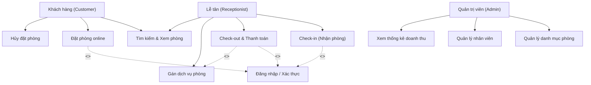
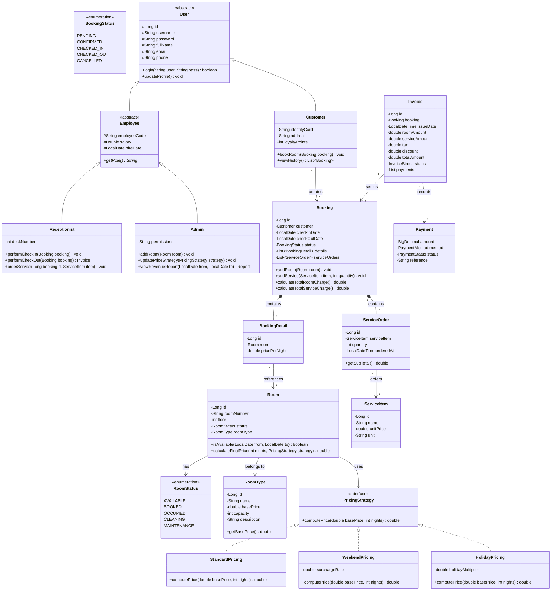
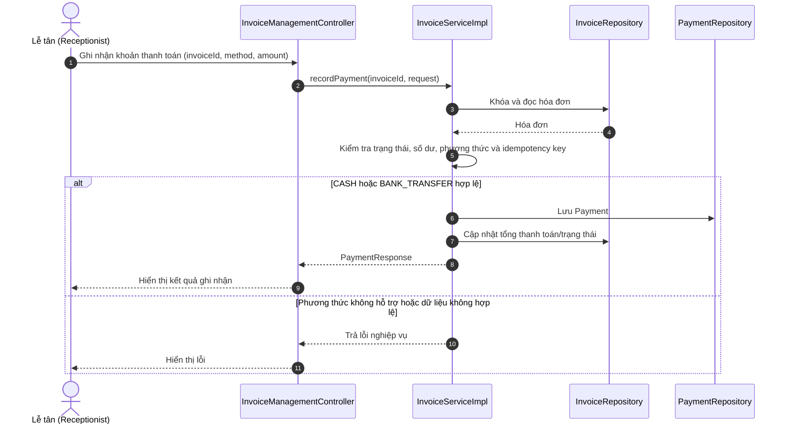
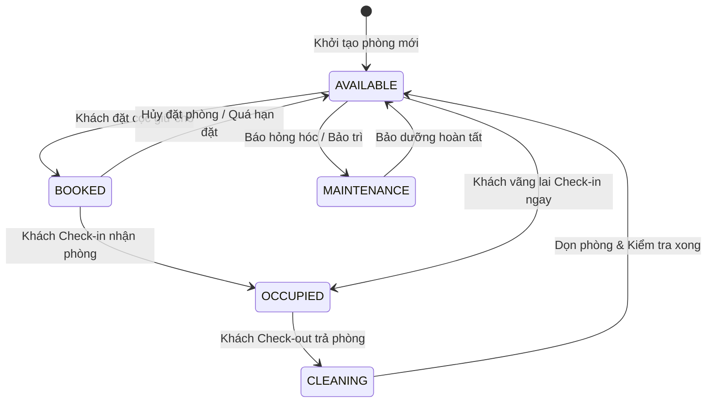

# TÀI LIỆU THIẾT KẾ HỆ THỐNG VÀ UML (OBJECT-ORIENTED DESIGN)
## ĐỀ TÀI: WEB QUẢN LÝ KHÁCH SẠN (HOTEL MANAGEMENT SYSTEM)
**Công nghệ:** Java 17+, Spring Boot 3, Spring Data JPA, Spring Security, MySQL  
**Phương pháp thiết kế:** Lập trình Hướng đối tượng (OOP) & Design Patterns

---

## 1. GIỚI THIỆU & MỤC TIÊU HỆ THỐNG

Dự án xây dựng một ứng dụng web quản lý khách sạn đáp ứng các yêu cầu nghiệp vụ thực tế, đồng thời thể hiện xuất sắc 4 trụ cột của lập trình hướng đối tượng (OOP) và các mẫu thiết kế (Design Patterns) phổ biến trong kỹ nghệ phần mềm.

### 1.1. Các nhóm người dùng (Actors)
* **Khách hàng (Customer):** Đăng ký tài khoản, tìm kiếm phòng trống theo ngày, xem chi tiết phòng, đặt phòng (Booking) trực tuyến, theo dõi lịch sử đặt phòng.
* **Lễ tân (Receptionist):** Quản lý trạng thái phòng thời gian thực, làm thủ tục Check-in (nhận phòng), Check-out (trả phòng), gán dịch vụ (giặt ủi, ăn uống, minibar) vào phòng, in hóa đơn.
* **Quản trị viên (Admin):** Quản lý toàn bộ danh mục phòng, loại phòng, tài khoản nhân viên, cấu hình bảng giá & chiến lược giá, xem báo cáo thống kê doanh thu.

---

## 2. ỨNG DỤNG CÁC NGUYÊN LÝ OOP & DESIGN PATTERNS

### 2.1. Bốn trụ cột OOP
1. **Tính đóng gói (Encapsulation):**
   * Tất cả các thuộc tính của các lớp thực thể (Entity/Domain model) đều có phạm vi truy cập `private` hoặc `protected`.
   * Truy cập và biến đổi dữ liệu thông qua các phương thức Getter/Setter và các phương thức nghiệp vụ có validation dữ liệu nghiêm ngặt.
2. **Tính kế thừa (Inheritance):**
   * Lớp người dùng cơ sở `User` được kế thừa bởi `Customer` và `Employee`.
   * Lớp `Employee` tiếp tục được kế thừa bởi `Receptionist` và `Admin`.
3. **Tính đa hình (Polymorphism):**
   * `PricingStrategy.computePrice()` được triển khai cho giá tiêu chuẩn, cuối tuần và ngày lễ.
   * Thanh toán hiện được kiểm tra và ghi nhận trong `InvoiceServiceImpl`; dự án không sử dụng payment strategy/gateway giả lập.
4. **Tính trừu tượng (Abstraction):**
   * Trừu tượng hóa qua các lớp người dùng cơ sở (`User`, `Employee`) và interface `PricingStrategy`.

### 2.2. Design Patterns áp dụng
* **Strategy Pattern:** Áp dụng cho thuật toán tính giá ngày thường/cuối tuần/ngày lễ.
* **Factory Pattern:** `PricingStrategyFactory` chọn chiến lược giá. Thanh toán không dùng Strategy/Factory; backend chỉ ghi nhận phương thức được hỗ trợ trong `InvoiceServiceImpl`.

---

## 3. SƠ ĐỒ USE CASE (USE CASE DIAGRAM)



---

## 4. SƠ ĐỒ LỚP CHI TIẾT (CLASS DIAGRAM)



---

## 5. SƠ ĐỒ TUẦN TỰ (SEQUENCE DIAGRAM)
### Luồng nghiệp vụ: Check-out và Thanh toán hóa đơn

Mô hình hóa việc lễ tân ghi nhận khoản thanh toán hóa đơn. Backend không gọi cổng thẻ/VNPay; chỉ nhận CASH hoặc BANK_TRANSFER được xác minh thủ công.



---

## 6. SƠ ĐỒ TRẠNG THÁI PHÒNG (ROOM STATE DIAGRAM)



---

## 7. CẤU TRÚC DỰ ÁN CHI TIẾT THEO CÁC TẦNG (LAYERED ARCHITECTURE)

Dự án tổ chức theo các tầng `Controller` → `Service` → `Repository` → `Database`, đồng thời tách biệt các gói `dto`, `entity`, `enums`, `exception`, `config` và `strategy/pricing`.

```text
hotel-management-system/
├── pom.xml                                 # Quản lý dependencies (Spring Boot 3, JPA, Security, Lombok, Swagger)
├── .gitignore
├── src/
│   ├── main/
│   │   ├── java/com/hotel/
│   │   │   ├── HotelManagementApplication.java # Main Spring Boot App
│   │   │   │
│   │   │   ├── config/                     # Tầng Cấu hình hệ thống
│   │   │   │   ├── OpenApiConfig.java       # Cấu hình Swagger/OpenAPI 3
│   │   │   │   └── SecurityConfig.java      # Cấu hình Spring Security & PasswordEncoder
│   │   │   │
│   │   │   ├── enums/                      # Tầng Định nghĩa Enum kiểu dữ liệu
│   │   │   │   ├── RoomStatus.java          # AVAILABLE, BOOKED, OCCUPIED, CLEANING, MAINTENANCE
│   │   │   │   ├── BookingStatus.java       # PENDING, CONFIRMED, CHECKED_IN, CHECKED_OUT, CANCELLED
│   │   │   │   ├── RoleName.java            # ROLE_ADMIN, ROLE_RECEPTIONIST, ROLE_CUSTOMER
│   │   │   │   └── PaymentMethod.java       # CASH, CREDIT_CARD, VNPAY
│   │   │   │
│   │   │   ├── entity/                     # Tầng Thực thể JPA (Áp dụng OOP Kế thừa & Đóng gói)
│   │   │   │   ├── BaseEntity.java          # Abstract class (id, createdAt, updatedAt)
│   │   │   │   ├── User.java                # Abstract class (Kế thừa JOINED)
│   │   │   │   ├── Customer.java            # Kế thừa từ User
│   │   │   │   ├── Employee.java            # Abstract class kế thừa từ User
│   │   │   │   ├── Receptionist.java        # Kế thừa từ Employee
│   │   │   │   ├── Admin.java               # Kế thừa từ Employee
│   │   │   │   ├── RoomType.java            # Bảng loại phòng
│   │   │   │   ├── Room.java                # Bảng phòng
│   │   │   │   ├── Booking.java             # Bảng đơn đặt phòng
│   │   │   │   ├── BookingDetail.java       # Chi tiết từng phòng trong booking
│   │   │   │   ├── ServiceItem.java         # Danh mục dịch vụ khách sạn
│   │   │   │   ├── ServiceOrder.java        # Dịch vụ phát sinh theo booking
│   │   │   │   └── Invoice.java             # Hóa đơn thanh toán
│   │   │   │
│   │   │   ├── repository/                 # Tầng Truy xuất Cơ sở dữ liệu (Spring Data JPA)
│   │   │   │   ├── UserRepository.java
│   │   │   │   ├── CustomerRepository.java
│   │   │   │   ├── RoomTypeRepository.java
│   │   │   │   ├── RoomRepository.java      # Chứa Query chống Overbooking
│   │   │   │   ├── BookingRepository.java
│   │   │   │   ├── ServiceItemRepository.java
│   │   │   │   └── InvoiceRepository.java
│   │   │   │
│   │   │   ├── strategy/                   # Chiến lược tính giá
│   │   │   │   ├── pricing/                 # Chiến lược tính giá phòng
│   │   │   │   │   ├── PricingStrategy.java
│   │   │   │   │   ├── StandardPricing.java
│   │   │   │   │   ├── WeekendPricing.java
│   │   │   │   │   ├── HolidayPricing.java
│   │   │   │   │   └── PricingStrategyFactory.java
│   │   │   ├── dto/                        # Tầng DTO (Data Transfer Object)
│   │   │   │   ├── request/
│   │   │   │   │   ├── AuthRequest.java
│   │   │   │   │   ├── RegisterCustomerRequest.java
│   │   │   │   │   ├── CreateRoomRequest.java
│   │   │   │   │   ├── BookingRequest.java
│   │   │   │   │   ├── CheckOutRequest.java
│   │   │   │   │   └── AddServiceOrderRequest.java
│   │   │   │   └── response/
│   │   │   │       ├── ApiResponse.java     # Chuẩn hóa Response toàn hệ thống
│   │   │   │       ├── RoomResponse.java
│   │   │   │       ├── BookingResponse.java
│   │   │   │       └── InvoiceResponse.java
│   │   │   │
│   │   │   ├── exception/                  # Tầng Bắt lỗi Ngoại lệ
│   │   │   │   ├── ResourceNotFoundException.java
│   │   │   │   ├── BadRequestException.java
│   │   │   │   └── GlobalExceptionHandler.java # Bắt lỗi tự động tập trung
│   │   │   │
│   │   │   ├── service/                    # Tầng Xử lý Nghiệp vụ (Business Logic)
│   │   │   │   ├── RoomService.java
│   │   │   │   ├── BookingService.java
│   │   │   │   ├── ReceptionService.java
│   │   │   │   ├── InvoiceService.java
│   │   │   │   └── impl/
│   │   │   │       ├── RoomServiceImpl.java
│   │   │   │       ├── BookingServiceImpl.java
│   │   │   │       ├── ReceptionServiceImpl.java
│   │   │   │       └── InvoiceServiceImpl.java
│   │   │   │
│   │   │   └── controller/                 # Tầng Giao tiếp REST API
│   │   │       ├── RoomController.java
│   │   │       ├── BookingController.java
│   │   │       ├── ReceptionController.java
│   │   │       └── InvoiceController.java
│   │   │
│   │   └── resources/
│   │       ├── application.yml             # Cấu hình MySQL, Port 8080, Hibernate
│   │       └── data.sql                    # Seed dữ liệu mẫu ban đầu
│   └── test/                               # Tầng Kiểm thử tự động (Unit Test JUnit 5)
└── docs/
    └── hotel_management_uml_design.md
```

---

## 8. PHÂN CHIA TRÁCH NHIỆM 4 THÀNH VIÊN THEO TỪNG TẦNG

1. **Thành viên 1 (Lead):**
   * Quản lý tầng `config/` (Security, OpenAPI), `exception/`, `ApiResponse.java`.
   * Quản lý phân quyền & tài khoản người dùng: `User`, `Employee`, `Admin`, `Customer`.
   * Dashboard & Thống kê hệ thống.

2. **Thành viên 2:**
   * Quản lý danh mục phòng: `Room`, `RoomType`, `RoomRepository`.
   * Phụ trách tầng `strategy/pricing/` (`StandardPricing`, `WeekendPricing`, `HolidayPricing`).
   * Phụ trách `RoomController`, `RoomService` và thuật toán tra cứu phòng trống.

3. **Thành viên 3:**
   * Phụ trách `Booking`, `BookingDetail`, `BookingRepository` và service đặt phòng.
   * Phụ trách `BookingController`, `BookingService` và thuật toán kiểm tra xung đột lịch đặt (Overbooking Prevention).

4. **Thành viên 4:**
   * Phụ trách dịch vụ và hóa đơn: `ServiceItem`, `ServiceOrder`, `Invoice`.
   * Phụ trách quy trình ghi nhận thanh toán thủ công cùng nghiệp vụ lễ tân/hóa đơn.

